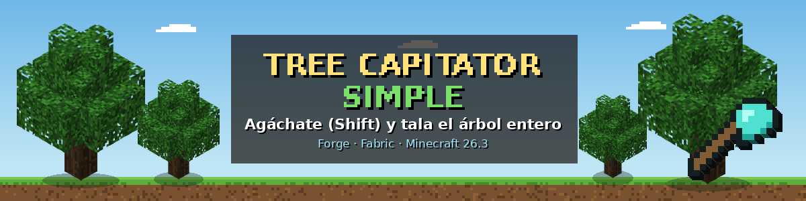

# Tree Capitator Simple — 26.1 y 26.2 (Fabric y Forge)

Agáchate (**Shift**), rompe la base de un árbol con un **hacha** y se talan todos los troncos conectados. Cada tronco gasta 1 de durabilidad. Sin configuración.

| Carpeta | Minecraft | Loader | Requiere |
|---|---|---|---|
| `fabric-26.2` | 26.2 | Fabric | Fabric Loader 0.19.3+, Fabric API |
| `fabric-26.1` | 26.1, 26.1.1 y 26.1.2 | Fabric | Fabric Loader 0.19.3+, Fabric API |
| `forge-26.2` | 26.2 | Forge | Forge 65.0.0+ |
| `forge-26.1` | 26.1, 26.1.1 y 26.1.2 | Forge | Forge 64.0.0+ |

Todas necesitan Java 25.

## Cómo funciona
- Agáchate y rompe el tronco de **abajo** del árbol con un hacha: caen todos los troncos conectados.
- Si el hacha no tiene durabilidad suficiente, tala solo los que alcance y no se rompe.
- Las hojas no se rompen. Sin agacharte o sin hacha, rompes un solo bloque normal.

## Cómo obtener los .jar
Entra en **Actions → Build todas las versiones**, abre la última ejecución y baja los 4 archivos de **Artifacts**.

## Licencia
MIT
